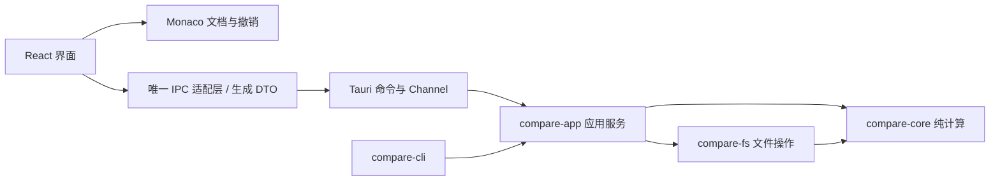

# 架构与技术规范

本文定义目标架构；实施状态以 [plan.md](plan.md) 为准，当前代码仍包含 egui 原型。

## 技术栈与依赖方向

| 层 | 技术 | 职责与边界 |
| --- | --- | --- |
| 计算与文件 | Rust | 文本算法、编码、路径、目录扫描、受保护的保存与复制 |
| 桌面宿主 | Tauri 2 | 系统 WebView、窗口、菜单、对话框、拖放、IPC 与打包 |
| 界面语言 | TypeScript strict | UI 逻辑与类型检查，不能替代 Rust 的运行时校验 |
| 界面与构建 | React + Vite + pnpm | 组织组件、开发热更新、生成本地静态资源 |
| 视觉 | Tailwind CSS + shadcn/ui + Lucide | 一套设计 token、按需引入的组件和图标 |
| 编辑器 | Monaco DiffEditor | 输入、选区、撤销、对齐、差异导航；能力须通过 FND-03 |
| 大列表 | TanStack Virtual | 目录展开后的可见行渲染，不负责扫描或树数据语义 |
| 类型契约 | ts-rs | 从专用 Rust DTO 生成 TypeScript，生成结果纳入版本管理 |
| 验证 | Rust tests、Vitest、Playwright | 分别验证核心、前端逻辑、浏览器交互；原生验证独立进行 |

TypeScript 是语言，React 是界面框架，Vite 是构建工具；三者运行在 Tauri 加载的前端中。最终安装包加载本地资源，终端用户无需 Node.js。首版不增加 SSR、全局状态框架、数据库或插件宿主。



这是目标依赖方向；CLI 现有直接调用 core/fs 可以保留，出现共用工作流时再移入 app。core 不依赖 GUI、Tauri 或文件系统；fs 不依赖 app；Tauri 命令不复制业务实现。不为形式上的分层增加空包装。

## 目录规划

下列标注“新增”的路径在对应任务实施时创建，不预建空模块。

```text
crates/
  compare-core/src/        文本快照、差异、查找；后续三方合并纯逻辑
  compare-fs/src/          编码、路径、扫描、保存、复制
  compare-app/src/         会话、文档注册、任务协调、持久化
  compare-cli/src/         无界面入口、返回码；保留现有回归
  compare-gui/src/         旧 egui 原型，迁移验收后退役
apps/desktop/             新增：React + TypeScript + Vite
  src/
    app/                  应用布局、启动与路由式视图切换
    features/
      text/               文本比较、编辑器适配
      directory/          树、过滤与选择
      operations/         复制预览和结果
      sessions/           会话、标签和恢复入口
    components/ui/        通用 UI 组件
    lib/ipc.ts            业务 IPC 调用的唯一入口
    lib/contracts/        Rust 生成的 DTO，禁止手改
    styles/               主题 token 与全局样式
  src-tauri/              新增：Cargo workspace 成员
    src/                  命令、DTO、启动、平台集成
    capabilities/         最小权限配置
fixtures/                 跨 Rust/UI/CLI 共用的可公开样本
scripts/                  原型启动、基准与构建辅助
AGENTS.md                 开发文档与 AI 工作流统一入口
docs/dev/                 开发规范、计划、AI 工作流与验收记录
  plan.md                 唯一任务账本与完成状态
  ai.md                   AI 开发流程与约束
  scripts/check-docs.mjs   文档与任务检查
.agents/skills/
  opencompare-development/ skill 注册入口，加载 docs/dev/ai.md
```

前端依赖集中在 apps/desktop，使用一个 pnpm-lock.yaml；Rust 继续使用根 Cargo.lock。只有出现第二个真实前端包才引入 pnpm workspace。文件按职责拆分，不按预估规模拆出空服务。

## 文档状态与保存协议

| 状态 | 唯一拥有者 | 其他层持有 |
| --- | --- | --- |
| 编辑正文、选区、撤销/重做 | Monaco model | React 只持有引用和摘要 |
| 当前标签、筛选、焦点、任务摘要 | React | 不在每次按键时复制全文 |
| 磁盘基线的原始字节、原文件格式、指纹、原生路径 | Rust 应用服务 | 前端只接收文档 ID 和只读摘要；成功写入后才推进基线 |
| 待保存的目标格式与格式修订 | 前端文档控制器，按文档 ID 与 Monaco model 配对 | React 显示受控摘要；Rust 仅在保存快照中接收并校验 |
| 保存基线与比较快照 | Rust 应用服务 | 前端保留已确认正文标记与目标格式的配对；比较快照不可变 |
| 目录扫描与复制计划 | Rust 应用服务 | 前端持有条目 ID、状态与展示数据 |

FND-01 先提供最小文档注册表：文档 ID、原生路径绑定、model 世代号的契约与稳定写入协调键。已有文件结合规范路径和可用文件身份识别别名；尚不存在的目标使用最近存在父目录的原生身份及剩余路径分量建立预留键，创建后在保护内重新绑定。大小写、链接和硬链接不能只靠小写字符串去重；别名无法确定时拒绝可疑并行写入。注册表不依赖 Monaco、保存协议或通用调度框架。

FND-06 消费该键实现同目标写入互斥与任务终态；FND-02 再绑定 Monaco model、目标格式、dirty 与保存基线。多个视图共享同一文档控制器，关闭重开使用新世代号，旧回执不得作用于新 model。此顺序为 FND-01 → FND-06 → FND-02；FND-03 的编辑器验证可在 FND-01 后并行进行。

首版在打开、保存和显式 Rust 重比边界传输有上限的完整快照。按键不经 Rust 往返，不预建持续增量镜像。只有 VAL-02 证明边界快照成为瓶颈后，才另作增量同步决策。

目标格式包含编码、BOM、换行策略及其他影响输出字节的格式选项；原文件格式是最近一次确认的磁盘事实，不能被用户下拉框直接改写。末尾换行属于正文状态；若增加强制末尾换行选项，它也必须进入目标格式。格式值先规范化并验证组合是否合法，格式修订用于识别异步请求，不单独决定 dirty。

dirty 比较“当前正文内容 + 当前目标格式”与“已保存正文内容 + 已提交格式”的完整状态；只改 BOM、GBK 转 UTF-8 或 LF/CRLF 目标策略也必须触发保存与关闭保护。正文基线采用与 model 相同的规范化表示，原始磁盘字节另存，不能因 CRLF 在编辑器内变成 LF 就误判已编辑。正文撤销回原值但格式仍不同时仍为 dirty；正文和目标格式均恢复保存值后才清除。

保存过程：

1. 同时捕获 model 世代、正文内容标记/修订、格式修订与目标格式，附带文档 ID、预期磁盘基线和请求 ID；它们组成一个不可变保存快照。
2. Rust 校验长度、格式组合、文档权限、身份和写入协调键。首版同文档有保存未结束时不接受第二次保存；正文与格式仍可继续编辑，避免排队保存持有过期磁盘基线。
3. 按快照目标格式编码并执行 compare-fs 写入保护；写入前再次检查磁盘基线。正文和目标格式均未变化时才允许复用原始字节，不能仅凭正文相同提前返回。
4. 成功回执绑定请求 ID、model 世代、正文标记、格式修订，返回实际提交格式及新磁盘指纹。Rust 推进磁盘基线；前端只推进该快照对应的保存基线，不覆盖当前正文或当前目标格式。
5. 保存过程中再次改正文或格式，按当前完整状态重新计算 dirty。例如提交 BOM 开启后又关闭，回执只能确认开启版本，不能将当前关闭选项重置或误标已保存。
6. 编码、格式校验或写入失败均保留当前正文、待保存目标格式和旧基线；显示重试、更换格式或另存为等补救。关闭时等待正在执行的写入终态，再判断是否仍有未保存状态。

FND-02 用状态与回执测试覆盖仅格式变更和交错，FND-04 接通真实字节转换及失败回归。正文用编辑器内容历史标记或内容校验比较，格式按规范化后的值比较，不能只比较两个修订数字。

迁移限制：现有 compare-fs 的 LoadedDocument::is_dirty 只比较正文，save_document 在正文不变时直接返回。FND-02、FND-04 必须补齐完整保存状态后才能支持仅格式转换；当前原型不具备上述协议。

## 应用实例与 Git 会话

FND-00 固定首版两种启动模式：普通桌面单进程实例；每次 Git difftool 调用启动一个独立的只读比较进程。单主窗口指每个 UI 进程一个主窗口，不等于整个系统只允许一个 UI 进程。文档身份和写入协调键属于各进程，只有普通桌面进程可写；Git 会话 ID 标识一次文件对的比较，不等于文档 ID、普通桌面会话或启动进程 ID。

- 普通首次启动创建唯一可写桌面实例。再次普通启动只激活已有窗口，不替换其正文/格式或未保存会话；首版不向运行中的实例转交新的路径任务，有路径参数时明确提示在已有窗口打开，不宣称已受理比较。
- Git 模式绕过普通桌面的单实例入口，CLI 直接启动并等待实际拥有本次只读窗口的进程，不能经由会转交给已有实例的启动器。专用窗口只读磁盘输入，禁用编辑、格式转换、保存、复制及会话配置写入，不接入其他窗口的未保存正文。
- 一次 Git 会话对应一对输入和一个独立进程。输入成功加载后才允许明确“完成比较”并返回 0；无错误时关闭窗口或取消返回 1，读取/启动失败或异常退出返回 2。这里的 0 表示查看完成，不表示文本相同；保留现有 diff/dir 的相同/不同/错误返回码语义。Git 集成说明应明确采用工具退出状态所需配置，GIT-01 用实际 Git 调用复核，不能只测子进程退出码。
- CLI 在会话终态、输入读取及文件句柄释放且专用进程退出后才返回。启动成功不是成功终态；无法确认完成时返回错误。Git 临时输入由调用方管理，应用不提前删除，也不在返回后继续读取。
- 连续调用各自等待各自会话；另一个会话完成不能释放本次等待。普通桌面有 dirty 文档时，Git 窗口明确显示“磁盘版本、只读”，不覆盖、不保存该文档，普通窗口的未保存状态保持不变。

M0 在 FND-00 确定并用骨架验证启动分流与隔离边界，不要求此时已有真实 dirty model 或完整 Git 会话；FND-01 定义会话/终态契约，GIT-01 实现并验收真实未保存工作与完整等待链路。首版不实现跨进程实时编辑同步或运行中桌面的 Git 请求队列；未来可写 mergetool 由 GIT-03 单独定义输出保护。

## 差异、规则与格式保真

- 一次导航、块选择、块接收使用同一份结果及其两侧修订。Monaco hunks 与 Rust hunks 不共享编号。
- FND-03 使用 Monaco 公开 API 验证对齐、导航、块接收进入统一撤销栈，加入 Windows/macOS 最小中文 IME 组合输入、真实 CSP 下离线 Release 资源/worker 加载、超长行和密集差异的限时降级。异步重算未完成时，旧块接收必须失效。
- Rust 比较服务用于 CLI、共享语义校验和后续三方合并；对同一规则的“相同/不同”判断必须一致，不强求不同算法生成相同块边界。
- 默认关闭会隐藏差异的编辑器选项。Monaco 的 ignoreTrimWhitespace 与仅忽略行尾空白、忽略大小写不是同一规则；未经验证的规则不显示为可用。
- UI 分开显示字节、文本、规则等价与格式差异，状态定义见 [产品规范](product.md)。文件元数据相同不能直接报告 byte_equal。
- 解码文本进入编辑器前建立明确的换行策略。普通统一 LF/CRLF 文件默认保留原格式与末尾换行；只有正文和目标格式均未变化才复用原字节。仅格式转换也是显式保存操作。
- 混合换行在可逆映射和编辑回写测试通过前只读。不可编码字符不得静默替换；GBK 等格式保存失败仍保留编辑内容。
- UTF-16 编辑器位置与 Rust UTF-8 字节范围不可直接互用。仅在真正需要跨边界范围时增加一个明确转换入口，覆盖 emoji、组合字符、CRLF；不为了未来增量协议提前构建映射层。
- 二进制、超长行、超过编辑上限、计算超时均有明确降级状态，不能以空结果表示相同。

FND-03 同时负责 M0 的文本编辑上限、峰值内存及冷/热启动初步预算，按 quality.md 记录实测和选择依据；未知或未验平台不得给出通过结论。VAL-02 在完整产品上补测目录、反复开关等负载并修订预算，完整无障碍仍属 UX-02，安装升级仍属 REL-01/REL-02。

## IPC 与任务生命周期

DTO 位于宿主边界，由 ts-rs 生成。文档 ID、任务 ID、修订等跨语言大整数采用字符串或受限并明确验证的安全整数，不能把 Rust u64 无条件变成 JavaScript number。生成类型不是授权校验。

建议按业务动作提供 open、compare、save、scan、prepare_copy、execute_copy、cancel 等命令；名字在实现时统一，不建立任意文件读写或任意命令执行接口。

- 请求携带任务 ID、所属会话和必要输入修订；Rust 检查 ID 存在、状态允许、长度/数量限制和目标权限。
- 错误使用稳定 code、可本地化信息参数、可重试性和非敏感上下文；系统错误详情供受控诊断，不作为 UI 唯一提示。
- 原生路径保留为 PathBuf/OsString，前端展示路径不是权限依据；前端选中条目 ID 由 Rust 解析到已授权根。无法无损表示的文件名要标明并保留原生身份。
- 目录条目分批通过 Tauri Channel 返回，批大小、队列长度和进度频率有上限；取消与关闭释放监听。普通事件仅用于低频通知。
- 同会话的旧读任务可以取消、丢弃结果；不同会话不互相覆盖。
- 保存和复制的提交结果不可因启动另一个任务而丢弃；完成、失败、取消恰好进入一个终态，实际已提交文件始终保留报告。
- 阻塞文件工作移出 UI/命令响应线程；并发和大缓冲有界。取消是协作式，界面响应与系统调用停止延迟分别记录。

## 文件系统与目录模型

目录状态包含未扫描、扫描中、完成、错误和取消。树模型以稳定条目 ID 为主键，逐批聚合父节点；过滤只影响视图，排除规则影响扫描范围，二者在 UI 中分开。虚拟列表只渲染展开且可见行，选中状态不依赖 DOM。

路径默认按原始相对名称精确配对；可选大小写/Unicode 规范化匹配必须检测一对多碰撞。Windows/macOS 的大小写和 Unicode 行为不能按系统名推定，须覆盖实际卷设置。链接、reparse point、循环、无法读取、消失的文件均返回可解释状态；默认不跟随目录链接。

保存与复制复用 compare-fs，并补充以下门槛：

- 预览不写目标；执行前验证源和目标指纹、类型及选定根约束。
- 复制来源读取磁盘版本并提示未保存编辑；目标复制期间采用下述冻结策略，共用 FND-01 的写入键和 FND-06 的互斥/终态能力。
- 同目录临时文件写完后替换，平台提交语义必须真机验证。取消发生在提交之后时报告成功，不能把已写入项目改成未执行。
- 失败不破坏原目标；另存为和目标新出现同样做覆盖检查。临时文件清理只针对本任务创建并记录的文件。
- ACL、ADS、xattr、资源分叉、硬链接关系和可执行权限列入支持矩阵；不假定普通字节复制保留全部元数据。影响安全或使用语义而未支持的类型拒绝操作或明确告知。
- 检查与提交之间存在平台竞争窗口；不能声称对任意外部进程修改完全无竞争。高风险窗口由复现测试和平台原语降低。
- 批量操作不是整批事务，失败后重新预览；删除型同步另行设计。

### 复制期间的目标编辑冻结

首版从执行准备开始保护整批目标，直到终态处理结束；预览阶段不冻结。冻结覆盖正文、IME 提交、格式设置、撤销/重做、块接收、重载以及保存/另存到这些目标，不能只设置一个 Monaco readOnly 选项。

1. 执行请求先按写入键一次性预留全部目标，包括尚不存在的目标及别名。与保存/其他复制冲突则拒绝本次启动并释放已预留键，不部分开工或排队等待。
2. 前端同步关闭所有目标 model 的变更入口并回报当前正文标记、格式修订、dirty 与世代；有 IME 组合时先结束或取消该组合，不能丢字符。冻结前最后一笔输入若已产生 dirty，整批拒绝；任何目标未确认冻结时都不得开始磁盘写入。
3. 冻结确认后再次校验源/目标磁盘指纹并执行。期间再次打开目标仅显示受保护状态，延后建立可编辑 model；同文件别名也受限，不通过重新打开绕过保护。
4. 完成回执先保留逐项已提交结果；仅对同保护令牌、同 model 世代、正文/格式标记仍符合冻结快照且保持 clean 的目标重载。任何条件不符都保留现有内容与格式，显示磁盘冲突，不自动覆盖新输入。新打开请求在终态后重新读盘。
5. 重载/失效标记处理完再解除冻结和预留键；重载失败标明结果不可用并提供重载/另存为，不把旧内容标成最新。成功、取消、部分失败、准备失败都通过同一清理出口解除保护。取消请求不是终态，未停止的写入仍受保护；窗口消失时先取消并收敛写入再释放，进程崩溃后的重新打开须重读磁盘。

OPS-01 实现预留、冻结确认和脏检查；OPS-02 接通执行、受条件约束的重载与全部终态清理；VAL-01 对启动后输入、重新打开、迟到回执、取消与失败做回归。

## 配置、恢复与隐私

通过 Tauri 平台目录 API 取得应用配置/数据目录，以稳定应用标识隔离，禁止默认写入安装目录。配置用带版本 JSON，原子替换并限制体积，按序执行迁移；保留损坏与未来版本文件，禁止自动重置覆盖。

旧原型配置只在明确的已知位置尝试迁移；迁移成功也保留旧文件。不扫描磁盘猜配置来源。会话默认只存路径、规则和偏好，不含文件正文。日志默认不记正文，路径可脱敏，诊断导出由用户选择。

SES-03 的恢复草稿单独设计为显式启用，注明正文会落盘、保留期限与清除方式；不能把普通会话恢复宣传为未保存正文恢复。首次恢复必须核对磁盘变化，不能自动覆盖。

前端仅加载打包资源，Monaco worker/语法资源本地化；采用 CSP、按窗口配置的最小 Tauri capabilities。正文按文本呈现，禁止当作 HTML。通用前端 fs/shell 权限不能绕过 Rust 文件操作保护。

## 决策与演进

| 决策 | 当前结论 | 重新评估条件 |
| --- | --- | --- |
| 编辑器 | 优先 Monaco，FND-03 为技术门槛 | 必要的对齐、撤销、规则或双平台性能不通过 |
| 文档同步 | 边界完整快照 | 实测保存/显式重比序列化成为瓶颈 |
| 状态管理 | React 内置 + Monaco model | 跨特性状态重复与更新问题有可复现证据 |
| 合并库 | 现有 similar 2.7 继续用于双向比较 | GIT-02 评估三方算法，不假设已有 3.x TextMerge |
| 原型迁移 | 复用 core/fs，逐步接入 app | 新桌面覆盖原型回归并通过原生验收后退役 egui |
| 版本锁定 | Cargo.lock、前端锁文件、工具链版本 | 依赖升级单独验证，不跟随浮动 latest 自动变更 |

首版接口、实例模式和正式应用标识在 M0 确定。FND-00 记录暂定最低 OS/WebView 范围、三目标测试环境、验收负责人及签名资源可用性，未知项明确标注；最低系统版本与正式支持矩阵在 REL-01 完成真实验证后确定并公布。资源记录只在 release.md 维护。变更核心决策时更新本文对应条目，只有存在复杂取舍才新增单独 ADR。

## 官方参考

- [Tauri 前端配置](https://tauri.app/start/frontend/)、[Channel](https://tauri.app/develop/calling-frontend/)、[Capabilities](https://tauri.app/security/capabilities/)。
- [Monaco DiffEditor 选项](https://microsoft.github.io/monaco-editor/typedoc/interfaces/editor_editor_api.editor.IDiffEditorOptions.html)；实际行为以锁定版本与共享样本为准。
- [React 外部状态订阅](https://react.dev/reference/react/useSyncExternalStore)、[shadcn/ui](https://ui.shadcn.com/docs)、[TanStack Virtual](https://tanstack.com/virtual/latest/docs/introduction)、[ts-rs](https://github.com/Aleph-Alpha/ts-rs)。
